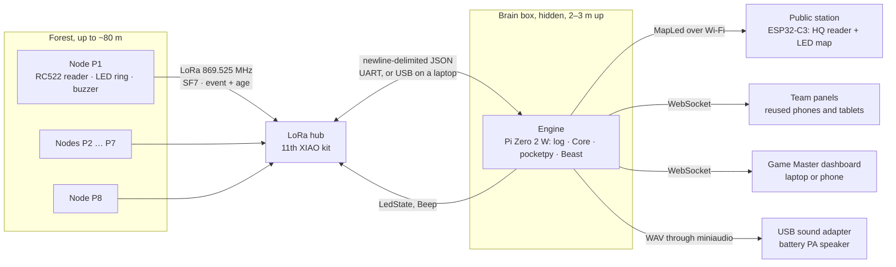
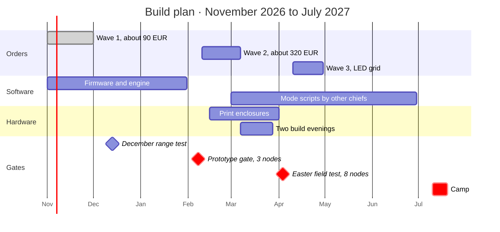
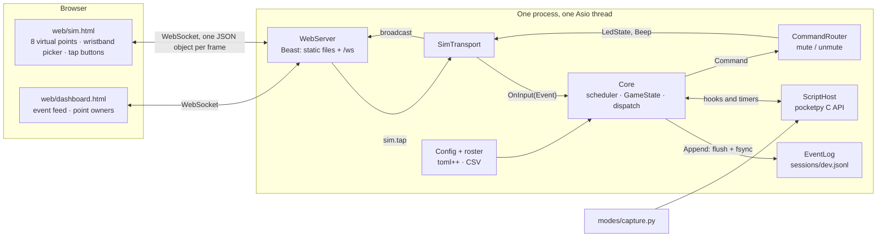
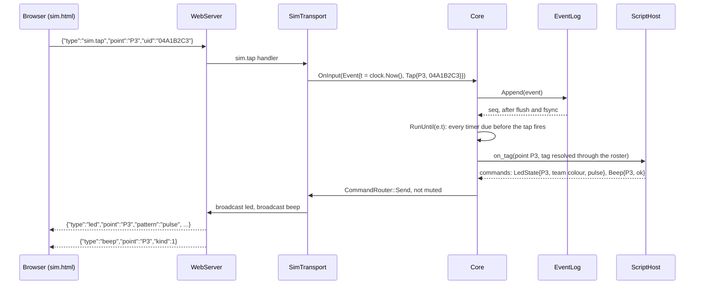
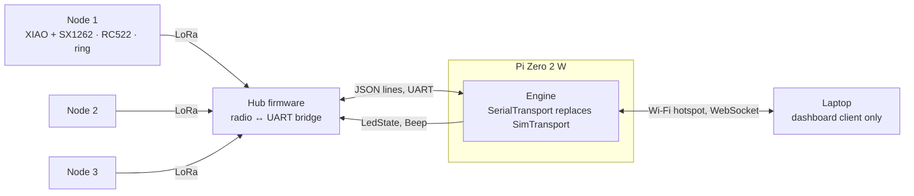
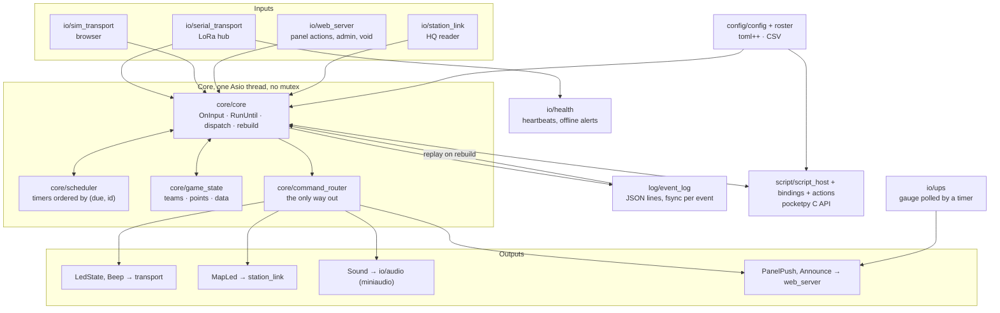
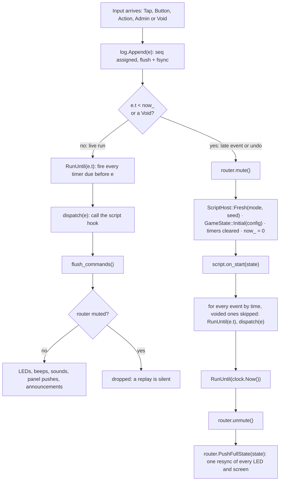

**Source:** <https://claude.ai/artifact/33tRh14gMZabNhPQq425q3> — four tabs: "24h Game Capture
System — Design", "Explained in pictures", "Box plan" and "Code architecture", copied here in tab
order as the four top-level sections below.

**Copied:** 22 October 2026.

**Status:** this file is the working copy. The Claude Docs document above is the origin and is not
read again; from now on every design decision is recorded here, in the same commit as the code that
implements it, with the change named in the commit body. `docs/PROGRESS.md` keeps the decisions log.

Text, tables and code blocks are verbatim. The drawings of the original document could not be
copied: each is replaced, keeping its caption, by a Mermaid diagram where it is a flow, sequence or
block diagram, and by a short written description otherwise.

# 24h Game Capture System — Design

Oct 21, 2026 · @Higginson Julien

Plain-language tour with drawings, for people new to the project: Explained in pictures

## Decisions at a glance

Build 8 identical field nodes that read RFID wristbands and report over LoRa radio to one HQ hub; all game rules live in a C++ engine with embedded Python-syntax scripts, on a Raspberry Pi Zero 2 W the scouts own, and the nodes stay dumb so a new game never requires reflashing anything.

| Area | Decision | Reason |
| --- | --- | --- |
| Radio | LoRa, 869.525 MHz EU licence-free band | 100 m through forest is trivial for LoRa; the module is a transceiver, so two-way costs nothing extra |
| Player input | One 13.56 MHz RFID reader per node, one tag per scout | Replaces 6 buttons; identifies team AND player; no moving parts; any number of teams; tags double as game items |
| Generic input | One large arcade button per node (optional connector) | For modes where identity is irrelevant |
| Node feedback | RGB LED ring in team colour + piezo buzzer | Instant tap confirmation; visible at night; patterns for bomb, countdown, disabled |
| Node logic | Report taps, obey LED/buzzer commands, buffer events when the link drops | Rules change on the master only |
| Timing | Each packet carries the event's age; master back-computes the tap time | Well under 0.1 s precision without clock sync, survives retries and relays |
| Engine | C++ on Boost, pocketpy for scripts, event-sourced log, deterministic replay | Static binaries for Linux arm64, Linux x64 and Windows x64; script interpreter compiled in; crash recovery and dispute replay for free |
| Game-time host | Scout-owned Raspberry Pi Zero 2 W runs the engine (second one as spare); any laptop or phone opens the dashboard | About 25 € each, under 1.5 W, stays with the scouts; any laptop can replace it |
| Team displays | Web panels on reused phones or tablets; Nextion dropped | Free, touch, UI generated by each game script |
| LED map | Optional 12 × 10 grid of addressable pixels, driven over Wi-Fi by a small controller at the map | About 48 €, bought after the Easter field test; a hand-marked paper grid until then |

The node hardware is generic: the same box serves as capture point, relay, bomb site, checkpoint or respawn station depending only on the loaded game script.

## 15 scenarios and what they demand

Fifteen plausible games reduce to six input types, seven output types and one timing rule; the engine exposes exactly those, so any game built from them needs no new hardware or firmware.

| # | Scenario | How it plays | What the engine must provide |
| --- | --- | --- | --- |
| 1 | Domination (this camp) | Tag a point; after 5 min uncontested it is yours; income every minute while held | Tag events, per-point state, cancellable timers, repeating timers, team counters, LED pulse vs solid |
| 2 | King of the Hill | One central point; defenders hold, attackers must tag within a window | Team roles, countdown on panels, end condition, HQ sound at start/end |
| 3 | Plant and defuse | Bomb carrier holds an item tag; tags a site to plant; defenders tag to defuse | Item tags, global state machine, blinking LED, cancellable fuse timer, HQ sound |
| 4 | Frontier crossing | Each attacker who crosses the line tags a node once | Per-player state, once-per-player rule, score counter |
| 5 | Approach / stealth race | First team to tag its own point unseen wins | True-time ordering across points (better than 0.1 s), end-settle window, silent nodes |
| 6 | Checkpoint orienteering | Teams visit points in a set or free order, timed | Per-team progress, order validation, deny beep, leaderboard |
| 7 | Market and upgrades | Teams spend resources at HQ: double income, shield a point 10 min, buy intel | Panel actions with costs, buyer identity, timed rule modifiers |
| 8 | Trading | Team A sends resources to team B; both confirm | Two-step panel transactions, pending offers, audit trail |
| 9 | Territory board ("invading squares") | A grid on the map; attack or buy squares with resources | Custom state not tied to field nodes, freely addressable map LEDs, panel grid UI |
| 10 | Capture the flag | Carry a flag tag back and tag it at your base node | Item tags with holder and location state, base nodes per team |
| 11 | Respawn / medic | "Dead" players tag their base node, then wait a cooldown | Per-player timers, accept vs deny feedback, player status on panels |
| 12 | Random events | Storm neutralises all points; double income for 10 min | Seeded randomness (replayable), GM trigger buttons, announcements and sounds |
| 13 | Night fog of war | Node LEDs off at night; map shows owners only to buyers of intel | Global LED brightness and visibility control, per-team panel views, clock-time schedules |
| 14 | Courier relay | Player tags A, then must reach B within 2 min | Per-player chains with deadlines, partial credit |
| 15 | Chief override | A chief's admin tag shows battery level on the LED or resets the point | Role tags with admin power, node diagnostics |

The engine primitives that cover all fifteen:

- **Inputs:** tag at point (resolved to player, team, role or item), button at point, panel action, admin action, timer fired, point online or offline.
- **Outputs:** point LED (colour, pattern, brightness), point buzzer, HQ sound, map LED (any index, independent of points), panel content and actions, announcement, end of game.
- **State:** teams with named counters, players with status, items, points with owner and enabled flag, free-form data on each, live-editable parameters.
- **Time:** one-shot and repeating timers, cancellation, pause, clock-time schedules.
- **Ordering rule:** every event is processed at the moment it happened, not when its radio packet arrived (Radio link section).

## System architecture

Every tap reaches the host through one hub on one serial line, and the host drives everything players see: node LEDs, the HQ station, the panels and the speaker.



*Figure: system architecture · nodes, hub, engine, outputs*

The hub is the only radio hardware the host talks to, so moving the game from the Zero to any laptop means plugging the hub in by USB; the station and panels then need a phone hotspot or travel router for Wi-Fi, since Windows cannot start a hotspot offline.

## Field node hardware

Each node is one radio board, one RFID reader, one LED ring, a buzzer, an optional button and a battery holder in a sealed box; every part plugs or solders onto a small carrier board, so a chief with one evening of soldering practice can assemble it.

| Part | Choice | Role | Notes |
| --- | --- | --- | --- |
| Radio + microcontroller | [Seeed XIAO ESP32S3 + Wio-SX1262 kit](https://thepihut.com/products/xiao-esp32s3-wio-sx1262-kit-for-meshtastic-lora) | Runs the firmware, talks LoRa | RF part pre-assembled, antenna included, Li-ion charger on board (100 mA), ships with Meshtastic preinstalled |
| RFID reader | RC522 module, 13.56 MHz | Reads player and item tags | 13–26 mA working, 0–5 cm read range, shares the SPI bus with the radio on its own chip-select pin |
| Light | WS2812B ring, 12 LEDs | Owner colour and patterns | 18 mA per LED colour channel at full brightness; run dimmed, much lower at night |
| Sound | Passive piezo buzzer | Accept / deny / alarm beeps | Script can mute it (stealth games) |
| Button | 60 mm arcade button, optional | Identity-free input | Wired to one input pin |
| Power | 2 × 18650 in parallel, two single-cell holders | 24 h target, swap between phases | Insert both cells fully charged from the same charger; never mix charge levels |
| Battery sense | 2 × 100 kΩ divider to an analog pin | Reports voltage in heartbeats | Firmware sleeps below 3.4 V to protect cells |
| Enclosure | 3D-printed PETG box with lid gasket | Weather, knocks, mounting | See below |

**Enclosure** means the box that houses and protects the electronics. Print it in PETG or ASA, not PLA: PLA softens in a hot car or full sun. Design once, print ten: a flat top marked "TAP HERE" with the reader 2–3 mm under the plastic, a translucent dome or ping-pong-ball diffuser over the LED ring, a screwed battery hatch, a 2 mm drain hole at the lowest point, a silica gel bag inside, and two slots for a strap so the box hugs a trunk.

Drawings and parts list for the box: Box plan

**Pin plan** (XIAO pins; verify against the [Seeed wiki](https://wiki.seeedstudio.com/wio_sx1262_with_xiao_esp32s3_kit/) before soldering): SPI on D8/D9/D10 shared by radio and reader, reader chip-select D1 and reset D2, LED data D3, buzzer D4, button D5, battery sense D0. The radio's own control lines run through the kit's board-to-board connector and use none of these.

**Power budget** (estimate, to measure on the February prototype): microcontroller with radio listening \~45 mA, reader polling \~20 mA, LED ring dimmed \~30–60 mA, total 100–130 mA. Two 2,500 mAh cells give 5,000 mAh, about 38 h at 130 mA. If the measured average exceeds 200 mA, swap cells every phase instead.

**LED supply:** power the ring directly from the battery (3.0–4.2 V), not from a 5 V boost converter; at battery voltage the 3.3 V data line stays within the LED's input threshold, and no level shifter is needed.

**Robustness rule:** no jumper wires in the field. Breadboards for the prototype only; the field build uses soldered perfboard or a small ordered PCB with pin headers, and hot glue on every connector.

## Radio link

All devices share one LoRa channel at 869.525 MHz, inside the European sub-band 869.4–869.65 MHz that allows 10 % duty cycle and up to 500 mW ERP without a licence ([The Things Network, EU868](https://www.thethingsnetwork.org/docs/lorawan/regional-parameters/eu868/)); the busiest device, the gateway, transmits about 1.6 % of the time.

**Settings:** SF7, 125 kHz bandwidth, coding rate 4/5, 14 dBm. A 20-byte packet takes about 57 ms on air. At 100 m through forest this leaves a wide margin; SF and power are firmware constants, raised only if the range test demands it. Use a private sync word, different from the one Meshtastic uses, plus a network-ID byte, so other LoRa users on the same frequency are ignored.

**Traffic budget (estimate):** each node sends a heartbeat every 30 s plus its events, about 2 % of its allowance. The gateway answers events and pushes LED commands; at 8 nodes × 120 packets per hour it transmits about 58 s per hour, 1.6 % duty cycle.

**Packet format** (binary, 12–24 bytes; roster packets up to 255):

| Field | Bytes | Content |
| --- | --- | --- |
| Network ID | 1 | Rejects foreign packets |
| Source, destination | 1 + 1 | Node IDs; 0 = gateway, 255 = broadcast |
| Sequence | 2 | Per-sender counter for ACK and de-duplication |
| Type | 1 | TAG, BUTTON, HEARTBEAT, ACK, LED\_STATE, BUZZ, CONFIG, ROSTER |
| Hops left | 1 | Relay limit, starts at 2 |
| Age | 3 | Milliseconds since the event happened, updated at every transmission and relay hop |
| Payload | 0–14 | Tag UID, battery mV and RSSI, LED colour + pattern + version |

**Reliability:**

- Every event waits in an outbox until acknowledged; retries back off from 300 ms with random jitter. The master drops duplicates by (source, sequence).
- If the gateway is unreachable, the node keeps reading tags and stores events (hours of capacity in RAM). They are delivered, with correct timestamps, when the link returns.
- LED commands carry a full desired state plus a version number, never "change colour" deltas. Heartbeats report the version shown; a mismatch triggers a resend. The link heals itself.
- Three missed heartbeats mark a node offline on the dashboard. A heartbeat RSSI that shifts sharply from its baseline flags a node that may have been moved.

**Instant feedback without waiting for the master:** at game start the master broadcasts the roster (tag → team colour, \~500 bytes in two or three large packets). On a tap, the node applies a local rule chosen by the game script (show the tagger's colour, flash white, or nothing) within 50 ms, then the master's LED command confirms or corrects it about 150 ms later. The same local rule keeps the LED meaningful if the radio fails, which is exactly the manual fallback.

**Timestamps without clock sync:** the node records the tap on its own millisecond clock and sends the event's age, not a time of day. Relays add their holding time. The master computes:

```latex
t_{event} = t_{received} - age - t_{airtime}
```

Error stays within a few milliseconds per hop; crystal drift adds about 24 ms over a 10-minute offline backlog, still well under the 0.1 s target.

**Relays:** any node flashed with relay mode re-broadcasts packets it hasn't seen, decrementing hops; only designated relays do this, to avoid flooding. At an 80 m radius the expected count is zero or one. Raise the gateway antenna 2–3 m (mount the whole brain box on a tent pole or tree) before adding relays: height is the cheapest range.

**Range test in December, zero code:** the kits ship with Meshtastic. Set two of them to the ShortFast preset (SF7, 250 kHz, slightly less sensitive than the final settings) and use its built-in range-test module while walking the forest.

## Master software

The master is one C++ program, Boost for I/O and pocketpy running the game scripts, that turns an append-only event log into game state by replaying it through the loaded script; crash recovery, late radio packets, admin corrections and dispute review all fall out of that single design.

**Modules:**

| Module | Job | Built with |
| --- | --- | --- |
| Gateway driver | Newline-delimited JSON with the LoRa hub over a serial port: UART on the Zero, USB on a laptop | Boost.Asio `serial_port` |
| Simulator | Virtual nodes and tags in the browser: click to tap; develop modes without hardware | Dashboard JavaScript, same message format as the gateway |
| Event log | One JSON-lines file per session, flushed on every event | Boost.JSON |
| Core | Deterministic scheduler: orders events by true time, fires timers, calls script hooks | C++20 |
| Script host | Loads the mode, exposes the API, contains script exceptions | pocketpy (C11), bound through its C API or its pybind11-compatible layer |
| Config + roster | Reads the mode config and the tag roster | toml++ (header-only), a small CSV reader |
| Outputs | LED and buzzer commands, map pixels, sounds, panel updates | Boost.Asio; miniaudio for WAV playback |
| Web server | Dashboard and panels: static files plus one WebSocket per client; no internet needed | Boost.Beast |

Implementation guide with diagrams and code: Code architecture

**Event sourcing.** Every input (tag, button, panel action, admin action) is logged with its true timestamp before it is processed. Game state is never saved; it is recomputed by replaying the log through the script. Three rules make that safe:

1. Scripts read time and randomness only through the engine (`game.now`, `game.random`, seeded per session), never from the system clock.
2. Side effects (LED commands, sounds, panel pushes) are emitted only for live events, never during replay; after a replay the engine pushes the current state once.
3. Admin corrections are events too. "Void event #412" is appended, never edited in place, and the replay skips the voided event.

**What this buys:**

- **Crash recovery:** the host restarts, the service starts on boot, the log replays in under a second, the game resumes.
- **Late events:** a buffered tap that happened 4 minutes ago is inserted at its true time; the state is recomputed and LEDs and panels corrected.
- **Fair finishes:** `game.end()` is confirmed only after a settle window (default 2 s), so an earlier tap whose packet arrives later still wins.
- **Disputes:** the dashboard scrubs the timeline and shows the exact state at any moment, filtered by point, team or player.
- **Undo:** voiding a mistaken capture recomputes every resource count downstream of it.

**Portability:** three build targets, Linux arm64 (the Zero), Linux x64 and Windows x64. Windows on Arm runs the x64 build through its built-in emulation, so it needs no target of its own. Link Boost, pocketpy and the C++ runtime statically: each target ships as one executable beside a folder of web files, sounds and modes. CMake drives all three builds. Build the arm64 binary on your Pi 4 at home or in CI, against the same Raspberry Pi OS release the Zero runs; never compile on the Zero itself, whose 512 MB of RAM is too little for Beast-heavy code.

**Game-time host:** a Raspberry Pi Zero 2 W bought for the scouts, about 25 €, plus a second one on an identical SD card as cold spare. Its price escaped the 2025–2026 memory-driven Raspberry Pi price rises ([TechRadar](https://www.techradar.com/pro/we-want-to-make-sure-you-dont-pay-for-more-memory-than-you-need-raspberry-pi-reveals-further-price-rises-and-the-ram-shortage-is-once-again-to-blame)), and it draws [0.7 W idle with Wi-Fi on](https://pidramble.com/wiki/benchmarks/power-consumption). It runs the engine and its own Wi-Fi hotspot inside the brain box with the LoRa hub (HQ section). Your laptop or phone is only a dashboard client, so it can sleep or charge without stopping the game, and the dashboard keeps a live mirror of the log in case the SD card fails. As a last resort any laptop can take over: same engine, hub on USB, plus a phone hotspot or travel router for the Wi-Fi.

**Why two Zeros and not a chief's laptop** (decided 21 October 2026):

- **Not for height.** Only the radio hub needs to be high, and a long USB cable could provide that.
- **Power without mains.** The Zero draws about 1.5 W, so one power bank lasts 24 h. A laptop serving the game draws roughly 8–15 W, 200–350 Wh over 24 h: four to six power banks, and only if it charges over USB-C.
- **Wi-Fi.** Windows cannot start its mobile hotspot without an existing network connection ([Microsoft Q&A](https://learn.microsoft.com/en-us/answers/questions/1477390/how-to-activate-mobile-wireless-coverage-zone-in-w)), so a laptop host would need a separate travel router in the forest.
- **Left alone for 24 h.** Sleep, a closed lid, an update restart, battery saver or a firewall prompt each stop the game. A box that boots straight into the game has none of these.
- **Owned by the unit.** The game must not depend on one chief's personal laptop left in a tent, or on next year's Game Master owning a suitable one.
- **What a laptop does better:** its own battery bridges a power-bank swap, and it has a real screen.
- **Alternative considered:** one Zero, a chief's laptop as spare and a €27 travel router as Wi-Fi source, about the same cost. Two Zeros were kept.

## Game scripting

Games are defined in three layers, each for a different chief: dashboard settings for anyone, a config file and roster for anyone who can edit text, and a short Python mode script for whoever writes rules.

| Layer | Who | What it controls | Format |
| --- | --- | --- | --- |
| Dashboard | Any chief, live | Parameters, pause, corrections, sounds, announcements | Web page |
| Config + roster | Chiefs who edit text | Mode, teams, colours, points, parameter defaults, tag-to-player mapping | TOML file + CSV (spreadsheet-exportable) |
| Mode script | Chiefs who write short code | The rules | Python syntax run by pocketpy, 30–80 lines per mode |

Ship a mode library from day one (domination, king of the hill, plant and defuse, race, checkpoints) so most chiefs copy and tweak rather than write from scratch.

**Config file:**

```toml
mode = "domination"
title = "Camp 2027 - Day 1"

[params]
capture_delay_min = 5
income_per_min = 10

[[teams]]
name = "Wolves"
colour = "red"

[[teams]]
name = "Foxes"
colour = "orange"

[points]
P1 = { name = "Old oak", map_led = 0 }
P2 = { name = "Fallen trunk", map_led = 1 }
```

**Roster** (tags are enrolled by tapping them on the HQ reader; the dashboard fills the UID):

```csv
tag,player,team,role
04A1B2C3,Lucas,Wolves,player
04D4E5F6,Noah,Foxes,player
0490ABCD,Bomb,Attack,bomb
```

**Script API:**

| Kind | Call | Meaning |
| --- | --- | --- |
| Hooks | `@on_start`, `@on_end` | Setup and teardown |
| Hooks | `@on_tag(point=, team=, role=)` | A tag was read; filters optional |
| Hooks | `@on_button(point=)` | The node's button was pressed |
| Hooks | `@on_action("name")` | A panel or dashboard button was pressed |
| Hooks | `@every(minutes=1)`, `@at("22:00")` | Repeating and clock-time triggers |
| Hooks | `@on_offline`, `@on_online` | A node dropped out or came back |
| State | `game.teams`, `team.res["wood"]` | Teams and their named counters |
| State | `tag.player`, `tag.team`, `tag.role` | Who or what was tapped |
| State | `game.points`, `point.owner`, `point.enabled`, `point.data` | Points and free per-point data |
| State | `game.data`, `game.p.<param>`, `game.now`, `game.random` | Global data, live parameters, engine time, seeded randomness |
| Time | `game.after(seconds, fn, *args)`, `game.cancel(handle)` | One-shot timers |
| Output | `point.light(colour, pattern, brightness)`, `point.beep(pattern)` | Node LED (`solid`, `pulse`, `blink`, `off`) and buzzer |
| Output | `game.map(index, colour, pattern)` | Any LED on the HQ map |
| Output | `game.sound(file)`, `game.announce(text, to=)`, `game.log(text)` | HQ speaker, panel banner, event feed |
| Output | `game.offer(name, cost, action, to=)` | A button on team panels, auto-rendered |
| Output | `game.end(winner=)` | Ends the game after the settle window |

**The domination mode for this camp**, complete:

```python
from scoutgame import on_start, on_tag, every, minutes

@on_start
def setup(game):
    for p in game.points:
        p.owner = None
        p.data["claimant"] = None

@on_tag()
def tagged(game, point, tag):
    team, claimant = tag.team, point.data["claimant"]
    if team is claimant or (team is point.owner and claimant is None):
        return                                  # own colour again: nothing happens
    game.cancel(point.data.get("timer"))
    if team is point.owner:                     # owner breaks a running claim
        point.data["claimant"] = None
        point.light(team.colour)
        return
    point.data["claimant"] = team
    point.light(team.colour, "pulse")           # claimed, not yet owned
    point.data["timer"] = game.after(minutes(game.p.capture_delay_min), confirm, point, team)

def confirm(game, point, team):
    point.owner, point.data["claimant"] = team, None
    point.light(team.colour)                    # solid = owned
    game.log(f"{team.name} now holds {point.name}")

@every(minutes=1)
def income(game):
    for p in game.points:
        if p.owner:
            p.owner.res["wood"] += game.p.income_per_min
```

**Plant and defuse**, showing item tags and sounds:

```python
@on_tag(role="bomb")
def plant(game, point, tag):
    if game.data.get("site") is None:
        game.data["site"] = point
        point.light("red", "blink")
        game.sound("bomb_planted.wav")
        game.data["fuse"] = game.after(game.p.fuse_s, explode, point)

@on_tag(team="Defense")
def defuse(game, point, tag):
    if game.data.get("site") is point:
        game.cancel(game.data["fuse"])
        game.sound("bomb_defused.wav")
        game.end(winner=tag.team)

def explode(game, point):
    game.sound("explosion.wav")
    game.end(winner=game.team("Attack"))
```

The bomb becomes a tag, so no chief has to stand at each site.

**Failure containment:** an exception inside a hook is caught, shown on the dashboard with its line number, and the game continues; the faulty hook is skipped until fixed. Scripts are trusted chief code, not sandboxed.

**Script runtime:** pocketpy, a Python 3 interpreter written in C11 and compiled into the engine. Scripts keep Python syntax, decorators and f-strings; the standard library is reduced and pip packages do not exist, which mode scripts never need. `time`, `random` and `os` are not exposed: the engine registers `game.now` and `game.random` instead, so a script cannot break replay determinism even by accident. The engine registers the `scoutgame` module itself, so the import line in the examples works unchanged.

## HQ: panels, map, sound, dashboard, power

HQ splits into a hidden brain box (Pi Zero 2 W plus LoRa hub) and a public station (tag reader plus optional LED grid) beside one or two reused phones or tablets; everything together draws about 4 W, under 100 Wh for 24 hours, which the chiefs' own power banks cover.

**Team panels: web pages instead of Nextion.**

| Criterion | Nextion | Web panel on a reused phone or tablet |
| --- | --- | --- |
| Cost | Paid per screen; one per team broke the budget | 0 € with devices chiefs already own |
| UI design | Nextion Editor, Windows-only ([review](https://shkspr.mobi/blog/2017/07/review-nextion-hmi-touchscreen-with-gpio/)); a new screen file per game | Generated by the engine from `game.offer()` and the game state |
| Changing a game | Redesign and re-upload the screen file | Edit the script; panels follow |
| Connection | Wire to the master | Local Wi-Fi from the host |
| Touch | Resistive on most models | Capacitive |

One or two shared panels replace six: a scout taps a wristband on the HQ reader, and the panel shows that team's view and actions for 30 seconds. That also stops one team spending another team's resources.

**LED grid (optional, 120 cells):** a 12 × 10 grid of 12 mm addressable bullet pixels, three strings of 50, pushed through holes drilled in plywood or foam board under a printed grid. The 7–10 cm of wire between pixels sets the cell size, so the board is roughly 90 × 75 cm and readable from several metres, with no soldering between pixels. A 30 LEDs/m strip cut into ten rows also works, but gives a 40 × 33 cm board and 27 solder joints. Feed 5 V from a power bank at both ends of the chain and cap current in firmware at 2 A: 120 pixels at full white would draw about 7 A. Data goes through a 74AHCT125 level shifter. Scripts address cells as `game.map(row * 12 + col, colour)`. Buy it after the Easter field test; until then a chief marks a paper grid by hand.

**Brain box (hidden):** the Zero 2 W and the eleventh XIAO kit as LoRa gateway, wired UART to UART (Zero GPIO 14/15 to XIAO D7/D6, crossed, plus ground; 3.3 V logic on both sides) and fed from one power bank through the Zero's 5 V pin. Set `dtoverlay=disable-bt` in the Zero's config.txt so its stable full UART sits on those pins. On a laptop the same hub plugs in over USB; its firmware speaks on both ports. Mount the box 2–3 m up for radio range.

**Public station (visible):** an ESP32-C3 board on the Zero's Wi-Fi, carrying the HQ RC522 reader (tag enrollment, panel identification) and, later, the LED grid driver. It stands beside the panels, so nothing hidden is ever exposed to teens.

**Sound:** a USB sound adapter on the Zero's data port (micro-USB OTG adapter) into a battery PA speaker; one WAV file per event ("bomb planted", "phase over"), played through miniaudio. Check during the field test that it carries 80 m through trees.

**Admin dashboard:**

- Live map of points: owner, claimant, battery, signal, last heartbeat
- Team resources, editable with a mandatory reason line
- Event feed with filters; void any event; timeline scrubber for disputes
- Pause and resume (game time freezes, timers freeze)
- Live parameter editing, sound and announcement triggers
- Node tools: disable a point, set its owner, identify it (blink white)
- Tag enrollment: tap unknown tags at HQ and assign them

**HQ power budget (estimate):**

| Load | Power | 24 h energy |
| --- | --- | --- |
| Brain box: Zero 2 W with hotspot + LoRa hub | \~1.5 W ([Zero 2 W: 0.7 W idle with Wi-Fi](https://pidramble.com/wiki/benchmarks/power-consumption)) | \~36 Wh |
| Public station + LED grid at 20 % | \~2.5 W | \~60 Wh |
| Total | \~4 W | \~96 Wh |

A 20,000 mAh power bank stores about 74 Wh, roughly 59 Wh usable at 5 V. Two of the chiefs' banks cover HQ for the whole game, one for the brain box and one for the station; without the LED grid the station needs almost nothing. Phones and tablets used as panels run on their own batteries plus one power bank each.

## Bill of materials and budget

The core system costs about 411 € and the optional LED grid about 48 € more, 459 € in all, inside the 450–500 € available; the chiefs supply the power banks and SD cards, and the 18650 cells are bought separately as planned.

| Item | Qty | Unit (€) | Total (€) | Where to buy |
| --- | --- | --- | --- | --- |
| XIAO ESP32S3 + Wio-SX1262 kit (10 nodes + 1 hub) | 11 | 12 | 132 | [Seeed](https://www.seeedstudio.com/Wio-SX1262-with-XIAO-ESP32S3-p-5982.html) · [The Pi Hut](https://thepihut.com/products/xiao-esp32s3-wio-sx1262-kit-for-meshtastic-lora) |
| 13.56 MHz silicone wristband tags (players, items, spares) | 60 | 1 | 60 | [AliExpress](https://www.aliexpress.us/item/2255800246540763.html) · [5/10-pack](https://www.aliexpress.us/item/2251832869512061.html) |
| Raspberry Pi Zero 2 WH, header pre-soldered (host + spare) | 2 | 25 | 50 | [Kubii](https://www.kubii.com/en/nano-computers/3455-raspberry-pi-zero-2-w-5056561800004.html) · [buyzero](https://buyzero.de/en/products/raspberry-pi-zero-2-w) |
| PETG filament 2 kg (about 200 g per box); gaskets, screws, heat-set inserts, foam strip, silica gel | lot | — | 50 | [3DJake easyPETG](https://www.3djake.com/3djake/easypetg-black) |
| 4-slot 18650 charger, LiitoKala Lii-402 | 2 | 15 | 30 | [eBay.de](https://www.ebay.de/itm/363141328043) |
| RC522 reader with card and key fob (10 nodes + HQ station) | 11 | 1.50 | 17 | [AliExpress](https://www.aliexpress.com/i/1005005930418267.html) · EU: [Bits & Parts](https://www.bitsandparts.nl/en/rfid-rc522-controller-scanner-set-13.56mhz-p100397) |
| WS2812B 12-LED ring, sold in 5-packs | 10 | 1.50 | 15 | [AliExpress](https://www.aliexpress.us/item/3256804902821956.html) · EU: [Soldered](https://soldered.com/product/smart-led-ws2812b-ring12/) |
| 60 mm arcade button with microswitch | 10 | 1.50 | 15 | [AliExpress](https://www.aliexpress.com/item/1005003728061403.html) |
| Perfboard 5 × 7 cm, JST-XH connectors, resistors, wire | lot | — | 15 | [Perfboard](https://www.aliexpress.us/item/2255800316167581.html) · [JST-XH kit](https://www.aliexpress.us/item/2251832669448716.html) |
| Tree strap, hook-and-loop with buckle, 80 cm variant | 10 | 1 | 10 | [AliExpress](https://www.aliexpress.us/item/3256810208217214.html) |
| USB sound adapter + micro-USB OTG cable | lot | — | 8 | [Sound adapter](https://www.kiwi-electronics.com/nl/usb-audio-adapter-works-with-raspberry-pi-2244) · [OTG cable](https://www.kubii.com/en/hub-cables-adapters/2275-usb-to-micro-usb-cable-3272496011878.html) |
| 18650 single-cell holder, two per node wired in parallel | 20 | 0.20 | 4 | [AliExpress](https://www.aliexpress.us/item/3256805974642593.html) |
| ESP32-C3 SuperMini (HQ station) | 1 | 3 | 3 | [AliExpress](https://www.aliexpress.com/item/1005009729980531.html) |
| Passive buzzer module | 10 | 0.20 | 2 | [AliExpress](https://www.aliexpress.us/item/2255800704511068.html) |
| microSD cards: 16 GB (host) and 8 GB (spare), donated | 2 | 0 | 0 | Already owned; test before use |
| **Core total** |  |  | **411** |  |
| 12 mm WS2811 bullet pixel string, 50 LEDs, 5 V (optional grid) | 3 | 10 | 30 | [eBay.de](https://www.ebay.de/itm/353194839469) |
| Grid board, print, 74AHCT125, 5 V wiring (optional grid) | lot | — | 18 | [74AHCT125](https://thepihut.com/products/adafruit-74ahct125-quad-level-shifter-3v-to-5v-74ahct125) |
| **Total with LED grid** |  |  | **459** |  |

Prices are approximate for October 2026. Each link is one example listing: AliExpress listings change, so check the variant (12 LEDs, 5 V, 60 mm, single slot) before ordering, and expect European shops to charge about three times AliExpress for small modules. Checking listings raised the wristbands to about 1 € each, not 0.40 €. Buying the Zero 2 WH, with its header already soldered, removes the separate header. The SD cards come from spares at home: the system needs only a few GB, and a read-only system partition protects it better than a pricier card would. Not included: 22 × 18650 cells, power banks (chiefs'), speaker, phones or tablets for panels.

**Order in three waves.** Wave 1 in November, about 90 €: 3 kits, 3 readers, one 5-pack of rings, buzzers, 3 buttons, 10 wristbands, one Zero 2 WH. Wave 2, about 320 €, only after the February prototype passes, sized by what the test showed. Wave 3, the LED grid, after the Easter field test if the budget allows.

**If money runs short, cut in this order:** use the key fobs bundled with the readers plus cheap cards instead of wristbands (−50 €), skip the LED grid (−48 €), drop arcade buttons (−15 €). Do not cut the spare nodes or the spare Zero; spares are what turn a failure into a five-minute swap instead of manual tracking.

## Build plan and timeline

The prototype test in early February is the one decision point: it confirms range, battery life and tag reads before the second order of about 320 €, leaving March to build and the Easter break for the full field test.



*Figure: build plan · November 2026 to July 2027*

Dates are targets; the Easter field test assumes Saturday 3 April 2027 and moves with your actual break. AliExpress lead times of 2–4 weeks are already inside both order bars.

**Prototype gate (3 nodes, 1 hub, half a day in a forest).** Order wave 2 only if all pass:

- [ ] Range: every node position reaches the hub with at least 95 % of packets acknowledged on the first try
- [ ] Battery: measured average current at or below 150 mA, so two cells last 24 h
- [ ] Tags: at least 95 % of taps read first time through the lid, including with a wet lid
- [ ] Feedback: LED shows the tagger's colour within 0.5 s of the tap
- [ ] Recovery: pulling the host's power mid-game and rebooting restores the exact state

**Field test at Easter (8 nodes, real teens, at least 3 hours):**

- [ ] Zero events lost or double-counted in the log
- [ ] Another chief runs the dashboard for an hour without you
- [ ] Speaker audible at the farthest point
- [ ] Every node still above 50 % battery at the end

**Who does what:** you write the firmware and engine (November to January); other chiefs print enclosures, solder carrier boards in two build evenings, enroll tags, and each writes or tweaks one mode with the simulator before camp.

## Risks and mitigations

The highest risks are radio dead spots and battery life, and both are settled by measurement before wave 2 is ordered; everything else has a designed fallback.

| Risk | Mitigation | Fallback during the game |
| --- | --- | --- |
| Radio dead spot behind a slope | December range test on site; raise the hub; one relay node | Node buffers events and delivers them later with correct times |
| Battery runs flat | February consumption measurement; voltage in every heartbeat; dashboard alert at 20 % | Swap in charged cells at the next phase change |
| Rain gets in | PETG box, lid gasket, drain hole, silica gel; lacquer the boards | Spare node swapped in five minutes |
| RFID misreads through the lid | Reader 2–3 mm under the surface, marked tap zone, beep on every read | Tap again; the dashboard shows every read |
| Tags lost | 60 tags for about 40 players; enrollment at HQ takes 5 seconds | Re-assign a spare tag to the player |
| Host crash or power cut | Log replay on boot; read-only system partition; spare Zero 2 W with identical SD card; dashboard log mirror | Restart: the game resumes where it stopped |
| Bug in a mode script | Simulator tests before camp; exceptions caught per hook | Dashboard overrides; void wrong events |
| Node moved by teens | Strapped to the trunk; RSSI baseline shift flagged | Chief puts it back; the log shows when it moved |
| Interference from other LoRa users | Private sync word, network-ID byte | Move to 868.1 MHz (1 % duty cycle: heartbeats every 60 s, ACKs batched) |
| Only one person understands the system | Mode library, simulator, a written how-to; chiefs build the nodes themselves | Any chief can run the dashboard |

## Sources

Pages consulted on 21 October 2026; prices change, so re-check them when ordering.

- [The Things Network: EU863-870 MHz band](https://www.thethingsnetwork.org/docs/lorawan/regional-parameters/eu868/): ETSI sub-bands, 869.4–869.65 MHz at 10 % duty cycle and 500 mW ERP
- [The Pi Hut: XIAO ESP32S3 & Wio-SX1262 Kit](https://thepihut.com/products/xiao-esp32s3-wio-sx1262-kit-for-meshtastic-lora): price, battery charger, Meshtastic preinstalled, 862–930 MHz
- [Pi Dramble: Raspberry Pi power consumption benchmarks](https://pidramble.com/wiki/benchmarks/power-consumption): Pi 4 at 2.7 W idle, 5.1 W moderate load
- [Terence Eden: Nextion HMI review](https://shkspr.mobi/blog/2017/07/review-nextion-hmi-touchscreen-with-gpio/): Nextion Editor is Windows-only
- [Bits & Parts: RC522 RFID set](https://www.bitsandparts.nl/en/rfid-rc522-controller-scanner-set-13.56mhz-p100397): EU retail price
- [Soldered: WS2812B Ring12](https://soldered.com/product/smart-led-ws2812b-ring12/): EU retail price, 18 mA per LED

* [TechRadar: Raspberry Pi price rises, April 2026](https://www.techradar.com/pro/we-want-to-make-sure-you-dont-pay-for-more-memory-than-you-need-raspberry-pi-reveals-further-price-rises-and-the-ram-shortage-is-once-again-to-blame): Zero 2 W among the models with unchanged prices

- [Microsoft Q&A: Windows mobile hotspot without internet](https://learn.microsoft.com/en-us/answers/questions/1477390/how-to-activate-mobile-wireless-coverage-zone-in-w): the hotspot cannot be created without an existing connection

# How the 24h game system works

Today, chiefs spend the whole game running from tree to tree with a notebook to see which team holds what. This project replaces that with small boxes on the trees: scouts tap them with a wristband, the boxes tell a hidden computer at the base, and that computer keeps the score on its own. The chiefs go back to playing, animating and refereeing.

## The whole game at a glance

Eight boxes hang on trees up to about 80 m from the base; every tap travels by radio to one hidden box at the base, and that box keeps the official score.

*Figure: the forest from above · every part of the system.* A bird's-eye drawing of the playing
area: eight numbered boxes hang on trunks scattered through the trees, each up to about 80 m from
the base, with a thin radio arrow from every box to one hidden box at the base. The base itself
holds the hidden brain box on its pole, the light map, the tap station and a team screen, and a
loudspeaker; a chief with a phone stands beside them, holding the Game Master's screen.

What happens when a scout taps a point:

1. A scout holds their wristband against a box on a tree.
2. The box lights up in the team's colour and beeps, so everyone nearby sees who holds it now.
3. The box sends a short radio message to the base. At this distance, radio goes through trees without trouble.
4. The hidden brain box applies the rules of the game: if nobody else taps within 5 minutes, the point belongs to that team and earns it resources every minute.
5. The team screens and the light map at the base update by themselves. Scouts come there to check the scores and to spend or trade their resources.
6. The Game Master follows everything live on a phone or laptop and can pause the game, fix a mistake or make an announcement.
7. Big moments, like "a bomb has been planted", are announced on the loudspeaker for the whole forest to hear.

## A capture point up close

Each capture point is a sealed box strapped to a tree: a scout taps it with a wristband, and it lights up in that team's colour.

*Figure: one capture point · outside and inside.* Two drawings side by side. The outside view shows
the sealed box strapped to a trunk: the translucent dome glowing in a team colour on top, the "TAP
HERE" zone and the big round button on the front, the engraved point number, and the battery hatch
underneath. The cut-away beside it shows what fills the box: the reader board just behind the tap
zone, the LED ring under the dome, the radio board on the back wall with its antenna upright, and
the two cells in their own bay under a shelf.

The box decides nothing by itself. It reports the tap and shows whatever the brain tells it, so the same box can be a capture point today, a bomb site tomorrow and a checkpoint in another game. Batteries are swapped between game phases. If a box ever stops working, its light still shows the last team, and the chiefs carry on by hand until it is replaced.

## The brain box up close

The brain box is the only smart part of the system: a credit-card-sized computer and a radio receiver, hidden at the base and powered by an ordinary power bank.

*Figure: the brain box · on its pole and inside.* Two drawings. On the left the closed box is
strapped 2–3 m up a tent pole or tree at the base, out of reach and out of sight, with a cable
running down to a power bank. On the right the open box shows the credit-card-sized computer and the
eleventh radio kit beside it, joined by three short wires (two UART, one ground), and the power bank
feeding both.

It writes down every tap the moment it hears it, so nothing gets lost: after a battery change or a restart, it rereads its diary and the game continues exactly where it stopped. Arguments like "we had that point first!" are settled by replaying the diary. If it ever fails, any laptop can take its place in a few minutes.

## The base up close

The base is where the game becomes visible: a big light map shows who owns what, and scouts tap their wristband at a small station to open their team's page on a screen.

*Figure: the base · light map, tap station, team screen.* A drawing of the public corner of the
base: a large plywood board with a 12 × 10 grid of lit cells showing who owns what, a small station
box with a reader marked for wristbands beside it, and a reused phone on a stand showing one team's
page. A scout holds a wristband against the station reader while two others read the screen.

From that page a team spends what it has earned: double its income for a while, protect a point, or trade with another team. Each game decides what is for sale. The light map is optional: the first camp can use a paper grid marked by a chief, and the lights can be added later.

## The Game Master's screen

The Game Master runs the whole game from one screen: every point, every tap and every score, live.

*Figure: the Game Master's screen · points, live events, controls.* A mock-up of the dashboard on a
laptop: a map of the eight points at the top left, each with its owner, claimant, battery and signal;
a scrolling event feed on the right with a filter row and a void button on each line; team resources
in the middle with a mandatory reason field; and a control strip along the bottom for pause and
resume, live parameters, sounds and announcements.

Nothing is final until the Game Master says so. A mistaken tap can be undone, a dispute settled by looking at the exact moment it happened, and resources adjusted with a written reason. The screen works on a laptop or a phone, and any chief can learn to use it in an evening.

## Why it is worth it, and how to take part

The system gives the chiefs their game back, ends score disputes, and stays with the unit for every camp after this one.

**What changes for the chiefs**

- No more running from tree to tree with a notebook for eight hours: chiefs play, animate and referee.
- Scores are instant and exact. Every tap is in the diary, so a dispute is settled in a minute.
- One set of boxes runs many games: territory capture, king of the hill, bomb defusal, orienteering, stealth races. A new game means editing a text file, not building new hardware.
- It belongs to the unit and is reused camp after camp, for about 460 € in total.

**How every chief can take part**

- Print and finish the boxes on a 3D printer.
- Solder the electronics at two build evenings in March. No experience needed; it is learned on the spot.
- Test the first three boxes in February, then play the full test game during the Easter break.
- Invent a game: describe its rules in plain words; turning them into a short script is the easy part.
- Run the Game Master screen during one phase of the camp game.

**Calendar:** first test in early February, build evenings in March, full test game at Easter, camp in July.

# Capture point box: plan

One PETG box per capture point, about 90 × 160 × 65 mm, strapped to a trunk: light dome on top, tap zone and button in front, battery hatch underneath, ribs and strap ears at the back. Every size is a starting point; check it against the real parts when they arrive.

## Outside views

Players see only the front and the dome; the back is shaped to sit on a round trunk, and the strap ears hold it there.

*Figure: outside views · front, left, back, right.* Four orthographic drawings of the box, with
numbered balloons 1–12 matching the parts list. The front carries the tap zone, the big button and
the point number; the two side views show the drip edge over the lid seam and the strap ears with
their dark slots; the back shows the two trunk ribs and the ears again. In both side views the front
of the box faces the button: left on the left side view, right on the right side view.

In the side views the front of the box faces the button: left on the left side view, right on the right side view. The dark slots in the ears are where the strap passes.

## Top, bottom and inside

The batteries live in their own bay under a shelf, so swapping them never opens the electronics; the reader sits 2 mm behind the tap zone and the radio board on the back wall.

*Figure: top, bottom and cut-through views.* Three drawings with balloons 13–20. The top view shows
the light dome centred over the LED ring; the bottom view shows the battery hatch with its two thumb
screws and the drain hole at the lowest point; the cut-through shows the battery shelf separating the
two cells from the electronics, the reader 2 mm behind the tap zone wall, the radio board on the
upper half of the back wall, and the buzzer against the thin spot in the lid.

## Parts list

Twelve parts are visible from outside (1–12) and eight sit inside (13–20); each number matches the balloons on both drawings.

| # | Part | What it does | Build note |
| --- | --- | --- | --- |
| 1 | Light dome | Shows the team colour from every side, day and night | Transparent PETG, or half a ping-pong ball glued on; Ø 56 mm |
| 2 | Tap zone | Where the wristband is held | Recessed 1 mm, wall 2 mm thick there, "TAP HERE" embossed |
| 3 | Big button | Input for games without wristbands | 60 mm arcade button; size the hole from the real part |
| 4 | Front lid and gasket | Closes the electronics compartment | 4 × M3 screws into heat-set inserts; gasket in a 2 mm groove |
| 5 | Drip edge | Keeps rain off the lid seam | Top overhangs the lid by 3 mm |
| 6 | Strap ears | The strap passes through them around the trunk | Slot 4 × 28 mm, fits straps up to 25 mm wide |
| 7 | Trunk ribs | Centre the box on a round trunk and stop it sliding | Two ribs 8 mm high, 50 mm apart, with self-adhesive foam strip |
| 8 | Battery hatch | Swap cells without opening the electronics | 2 × M4 thumb screws, its own gasket |
| 9 | Drain hole | Lets condensation out | 2 mm, at the lowest point of the bay |
| 10 | USB-C service port | Firmware updates without opening the box | Tethered TPU or silicone plug |
| 11 | Point number | Chiefs identify the point at a glance | Engraved 1 mm deep, painted in |
| 12 | Breather vent (optional) | Limits condensation when nights get cold | Adhesive membrane vent over a 5 mm hole |
| 13 | RFID reader | Reads the wristband | Board 2 mm behind the tap zone wall |
| 14 | LED ring | Lights the dome | Glued under the top wall, centred on the dome |
| 15 | Radio board on carrier | Talks to the base, runs the box | XIAO kit on perfboard, on standoffs, upper half of the back wall |
| 16 | LoRa antenna | Radio range | Upright along the back wall, away from the batteries |
| 17 | Batteries | About a day of power | 2 × 18650 in single holders, wired in parallel |
| 18 | Silica gel bag | Absorbs moisture | Replace after each camp |
| 19 | Buzzer | Beeps on each tap | Against a 0.8 mm thin spot in the lid so the sound gets out |
| 20 | Battery shelf | Separates batteries from electronics | Cables pass through a sealed grommet |

## Printing and testing

One box takes about 200 g of PETG, so ten boxes plus a few failed prints need two 1 kg spools, not one.

- **Material:** PETG for body, lid and hatch. TPU for gaskets and the USB plug if the printer handles it; otherwise 2 mm silicone cord pressed into the groove.
- **Walls:** 2.5 mm everywhere, printed solid; 2 mm at the tap zone so the reader works through it.
- **Orientation:** body lying on its back with the open front facing up, so nothing needs supports. Print the two ribs separately and glue or screw them on.
- **Fixings:** 4 × M3 heat-set inserts for the lid and 2 × M4 for the hatch, 60 in total, set with the soldering iron.
- **Colour:** bright orange or yellow, so chiefs find the points quickly.
- **CAD:** FreeCAD or Onshape, with every size as a named parameter, so the box adapts when the real parts measure differently.

Tests on the first printed box, before printing the other nine:

- [ ] Reader: 20 taps out of 20 read first time through the tap zone wall
- [ ] Rain: 10 minutes under a shower with a paper towel inside; the towel stays dry
- [ ] Drop: three falls from 1.5 m onto hard ground; nothing cracks or comes loose
- [ ] Night: the dome is visible from 30 m at the dimmest LED setting

# Code architecture

Build the engine in three steps, each a working system: everything on a laptop with simulated capture points, then three real boxes and a hub for the February test, then the full camp system. The Core never changes between steps; each step only adds adapters around it.

## 1. Local prototype, no hardware

Everything runs in one process on your laptop: the browser plays the capture points, and the engine logs, schedules and calls the mode script exactly as it will at camp.



*Figure: local prototype · one process, simulated capture points*



*Figure: one simulated tap · sequence*

**Core types.** Everything that happens is an `Event`; everything the game wants done is a `Command`. Nothing else crosses module boundaries.

```cpp
// engine/core/event.hpp
#pragma once
#include <boost/json.hpp>
#include <cstdint>
#include <string>
#include <variant>

namespace sg {

using Millis = std::int64_t;                 // game time: ms since the session started

struct Tap    { std::string point; std::string uid; };
struct Button { std::string point; };
struct Action { std::string team, name; boost::json::object args; };   // from a team panel
struct Admin  { std::string name;       boost::json::object args; };   // from the dashboard
struct Void   { std::uint64_t target; };                                // undo one event

struct Event {
    std::uint64_t seq = 0;                   // set by EventLog::append, never reused
    Millis        t   = 0;                   // when it really happened
    std::variant<Tap, Button, Action, Admin, Void> data;
};

struct Rgb { std::uint8_t r, g, b; };
enum class Pattern : std::uint8_t { Off, Solid, Pulse, Blink };

struct LedState  { std::string point; Rgb rgb; Pattern pattern; std::uint16_t version; };
struct Beep      { std::string point; std::uint8_t kind; };
struct Sound     { std::string file; };
struct MapLed    { int index; Rgb rgb; Pattern pattern; };
struct PanelPush { std::string team; boost::json::object view; };
struct Announce  { std::string text, to; };            // team name or "all"

using Command = std::variant<LedState, Beep, Sound, MapLed, PanelPush, Announce>;

} // namespace sg
```

**Transport.** The only seam that changes between the laptop and the camp: the simulator implements it now, the radio in February.

```cpp
// engine/io/transport.hpp
class Transport {
public:
    using InputHandler = std::function<void(Event)>;
    virtual ~Transport() = default;
    virtual void start(InputHandler on_input) = 0;
    virtual void send(const LedState&) = 0;
    virtual void send(const Beep&) = 0;
};

// engine/io/sim_transport.hpp: the browser's simulator page plays the capture points
class SimTransport final : public Transport {
public:
    SimTransport(WebServer& web, Clock& clock) : web_(web), clock_(clock) {}

    void start(InputHandler on_input) override {
        web_.on("sim.tap", [this, on_input](const json::object& m) {
            on_input(Event{0, clock_.now(),
                           Tap{json::value_to<std::string>(m.at("point")),
                               json::value_to<std::string>(m.at("uid"))}});
        });
    }
    void send(const LedState& s) override { web_.broadcast("led", to_json(s)); }
    void send(const Beep& b)     override { web_.broadcast("beep", to_json(b)); }

private:
    WebServer& web_;
    Clock&     clock_;
};
```

**Core loop.** One Asio thread, so no locks anywhere: an input is logged, every timer due before it fires, then the hook runs. A 100 ms `asio::steady_timer` calls `tick()` so timers also fire between inputs. Ties between timers are broken by timer id, never by luck.

```cpp
// engine/core/core.cpp
void Core::on_input(Event e) {
    e.seq = log_.append(e);          // 1. durable first
    run_until(e.t);                  // 2. fire every timer due before this event
    dispatch(e);                     // 3. call the script hook, route its commands
}

void Core::tick() { run_until(clock_.now()); }

void Core::run_until(Millis t) {
    while (!timers_.empty() && timers_.top().due <= t) {
        Timer tm = timers_.top();     // priority queue ordered by (due, id)
        timers_.pop();
        now_ = tm.due;               // the script sees the timer's own time
        script_.fire_timer(tm.id, state_);
        flush_commands();
        if (tm.every > 0) timers_.push({tm.due + tm.every, tm.every, tm.id});
    }
    now_ = std::max(now_, t);
}

void Core::dispatch(const Event& e) {
    std::visit(overloaded{
        [&](const Tap& tap)  { script_.on_tag(state_, tap.point, roster_.lookup(tap.uid)); },
        [&](const Button& b) { script_.on_button(state_, b.point); },
        [&](const Action& a) { script_.on_action(state_, a); },
        [&](const Admin& a)  { script_.on_admin(state_, a); },
        [&](const Void&)     { /* handled by rebuild(), section 3 */ },
    }, e.data);
    flush_commands();
}
```

**Event log.** One JSON object per line, flushed to disk before anything else happens.

```cpp
// engine/log/event_log.cpp
std::uint64_t EventLog::append(Event e) {
    e.seq = next_seq_++;
    out_ << json::serialize(to_json(e)) << '\n';
    out_.flush();
    sync_to_disk(out_);              // fsync on Linux, FlushFileBuffers on Windows
    events_.push_back(std::move(e));
    return events_.back().seq;
}
```

**Script host.** The engine talks to pocketpy only through this class, so the interpreter can be swapped or upgraded in one place.

```cpp
// engine/script/script_host.hpp
class ScriptHost {
public:
    static ScriptHost fresh(const std::filesystem::path& mode, std::uint64_t seed);
    void on_start(GameState&);
    void on_tag(GameState&, const std::string& point, const Tag&);
    void on_button(GameState&, const std::string& point);
    void on_action(GameState&, const Action&);       // ActionError goes back to that panel
    void on_admin(GameState&, const Admin&);
    void fire_timer(TimerId, GameState&);
    std::vector<Command> drain_commands();            // what the last hook asked for
    const std::vector<ActionSpec>& actions() const;  // collected from @action decorators
};
```

The binding below is a sketch of pocketpy's pybind11-compatible layer; check the exact names on pocketpy.dev before relying on them.

```cpp
// engine/script/bindings.cpp
PYBIND11_EMBEDDED_MODULE(scoutgame, m) {
    py::class_<TeamRef>(m, "Team")
        .def_property_readonly("name",   &TeamRef::name)
        .def_property_readonly("colour", &TeamRef::colour)
        .def_property_readonly("res",    &TeamRef::resources)   // dict-like counters
        .def_property_readonly("data",   &TeamRef::data);       // free Python dict
    py::class_<PointRef>(m, "Point")
        .def_property_readonly("id", &PointRef::id)
        .def_property("owner", &PointRef::owner, &PointRef::set_owner)
        .def("light", &PointRef::light, py::arg("colour"), py::arg("pattern") = "solid");
    m.def("minutes", [](double n) { return static_cast<Millis>(n * 60'000); });
}
```

**WebSocket messages,** one JSON object per frame:

```json
{"type": "sim.tap", "point": "P3", "uid": "04A1B2C3"}
{"type": "led",     "point": "P3", "rgb": [255, 120, 0], "pattern": "pulse", "v": 12}
{"type": "action",  "name": "attack", "args": {"target": "D5", "force": {"archers": 4}}}
{"type": "panel",   "team": "Wolves", "sections": []}
```

**Build order:**

1. `Event`, `EventLog` and a replay test: log 1,000 random events, replay twice, compare a hash of the state.
2. Core scheduler with a fake clock you can fast-forward.
3. ScriptHost with `on_start`, `on_tag`, `after` and `every`.
4. Beast server: static files plus one WebSocket endpoint.
5. Simulator page, then the dashboard, then the team panel.

## 2. February prototype: three boxes, a hub and the Zero

Replace `SimTransport` with `SerialTransport` and add two small firmwares, node and hub; nothing above the transport changes, which is exactly what the February test proves.



*Figure: February prototype · three nodes, hub, Zero, laptop*

```mermaid
sequenceDiagram
    participant Scout
    participant N as Node
    participant H as Hub
    participant T as SerialTransport
    participant C as Core
    Scout->>N: wristband held against the tap zone
    N->>N: local rule from the roster: tagger's colour, under 50 ms
    N->>N: outbox.push(Tap, uid, millis())
    N->>H: LoRa packet, header carries age = millis() - createdAt
    H->>H: age += millis() - rxAt
    H->>T: {"src":3,"seq":17,"type":1,"age":212,"len":20,"rssi":-91,"body":"..."}
    T->>T: t = clock.Now() - age - airtime_ms(len)
    alt (src, seq) already seen
        T->>H: ACK again, do not log twice
    else new event
        T->>C: OnInput(Event{t, Tap})
        C->>C: Append, RunUntil(t), dispatch to the script
        C->>H: LedState{point, colour, pattern, version}
        H->>N: LoRa LedState
        N->>N: render; the next heartbeat reports led_version
    end
```

*Figure: one real tap over the radio · sequence*

**Shared packet format.** One header file compiled into both firmwares, so node and hub can never disagree on the bytes.

```cpp
// firmware/common/protocol.hpp
#pragma once
#include <cstdint>

namespace proto {

constexpr uint8_t NET_ID = 0x5C;               // ignore everyone else's LoRa

enum class Type : uint8_t { Tap = 1, Button, Heartbeat, Ack, LedState, Beep, Roster };

#pragma pack(push, 1)
struct Header {
    uint8_t  net;                              // NET_ID
    uint8_t  src, dst;                         // 0 = hub, 255 = broadcast
    uint16_t seq;                              // per sender, for ACK and de-duplication
    Type     type;
    uint8_t  hops;                             // relay budget, starts at 2
    uint8_t  age[3];                           // ms since the event, 24-bit little endian
};
struct TapBody   { uint8_t uid_len; uint8_t uid[7]; };
struct LedBody   { uint8_t r, g, b, pattern; uint16_t version; };
struct HeartBody { uint16_t battery_mv; int8_t rssi; uint16_t led_version; uint8_t outbox; };
#pragma pack(pop)

inline uint32_t getAge(const Header& h) { return h.age[0] | h.age[1] << 8 | h.age[2] << 16; }
inline void setAge(Header& h, uint32_t ms) {
    if (ms > 0xFFFFFF) ms = 0xFFFFFF;
    h.age[0] = ms; h.age[1] = ms >> 8; h.age[2] = ms >> 16;
}

} // namespace proto
```

**Node firmware.** A plain loop, no RTOS tasks: read tags, answer the radio, retry the outbox, render the LED.

```typescript
// firmware/node/main.cpp (Arduino framework, RadioLib, MFRC522, Adafruit_NeoPixel)
#include <RadioLib.h>
#include <MFRC522.h>
#include <Adafruit_NeoPixel.h>
#include "protocol.hpp"

SX1262 radio = new Module(41, 39, 42, 40);     // NSS, DIO1, RST, BUSY: check Seeed's pinout
MFRC522 reader(D1, D2);                         // chip select, reset
Adafruit_NeoPixel ring(12, D3, NEO_GRB + NEO_KHZ800);
Outbox outbox;                                  // events waiting for an ACK

void setup() {
  SPI.begin();
  reader.PCD_Init();
  ring.begin();
  radio.begin(869.525, 125.0, 7, 5, 0x12, 14);   // MHz, kHz, SF7, CR 4/5, sync word, dBm
  radio.setPacketReceivedAction(onRadioIrq);
  radio.startReceive();
}

void loop() {
  if (auto uid = readTag()) {                    // polled every ~100 ms
    led.localFeedback(roster.colourOf(*uid));    // under 50 ms, before the master answers
    outbox.push(proto::Type::Tap, *uid, millis());
  }
  if (radioIrq) handlePacket();                  // ACK, LedState, Roster
  outbox.retryDue(millis(), [](Pending& p) {     // 300 ms backoff plus random jitter
    proto::setAge(p.header, millis() - p.createdAt);
    sendPacket(p);
  });
  if (millis() - lastBeat > 30'000) sendHeartbeat();
  led.render(millis());                          // solid, pulse, blink
}
```

**Hub firmware.** No game logic: it adds the time each packet spent in the hub to its age and turns bytes into JSON lines, and back.

```cpp
// firmware/hub/main.cpp (ArduinoJson)
void onRadioPacket(const uint8_t* buf, size_t len, uint32_t rxAt) {
  proto::Header h;
  memcpy(&h, buf, sizeof h);
  if (h.net != proto::NET_ID) return;

  JsonDocument doc;
  doc["src"]  = h.src;
  doc["seq"]  = h.seq;
  doc["type"] = uint8_t(h.type);
  doc["age"]  = proto::getAge(h) + (millis() - rxAt);
  doc["len"]  = len;                            // for the airtime estimate
  doc["rssi"] = radio.getRSSI();
  doc["body"] = toHex(buf + sizeof h, len - sizeof h);
  serializeJson(doc, Serial1);                  // UART to the Zero
  Serial1.print('\n');
}
// Lines coming from the engine ({"dst": 3, "type": "led", ...}) are packed into
// proto structs and transmitted; the hub ACKs nothing itself.
```

**SerialTransport.** Reads one JSON line at a time and converts age into a true timestamp.

```cpp
// engine/io/serial_transport.cpp
void SerialTransport::read_line() {
    asio::async_read_until(port_, buf_, '\n', [this](boost::system::error_code ec, std::size_t n) {
        if (ec) return schedule_reconnect();     // hub unplugged: retry every 2 s
        std::string line(asio::buffers_begin(buf_.data()),
                         asio::buffers_begin(buf_.data()) + n);
        buf_.consume(n);

        auto j = json::parse(line).as_object();
        const Millis age = j.at("age").to_number<Millis>();
        const Millis t   = clock_.now() - age - airtime_ms(j.at("len").to_number<int>());

        if (dedup_.seen(j.at("src").to_number<int>(), j.at("seq").to_number<int>()))
            send_ack(j);                         // resent packet: ACK again, don't log twice
        else if (auto e = to_event(j, t))
            on_input_(std::move(*e));            // taps and buttons go to the Core
        else
            health_.update(j);                   // heartbeats go to the health monitor
        read_line();
    });
}
```

**Build order:**

1. December range test with stock Meshtastic, then node firmware: tag read, local LED, radio send.
2. Hub firmware and `SerialTransport`; the dashboard shows heartbeats and battery.
3. ACK, outbox and `LedState` round trip; measure the time from tap to team colour.
4. Unplug the hub for 5 minutes during a test: buffered taps must arrive with their real times.

## 3. Full architecture: the camp system

The camp adds four adapters (station, audio, UPS, health) and two mechanisms in the Core: rebuilding the state when a late tap or an undo arrives, and typed actions that generate the team panels.



*Figure: full system · module map*



*Figure: event lifecycle · live run or rebuild*

**Repository layout.**

```text
scoutgame/
├─ engine/                C++20, CMake, one static binary per target
│  ├─ core/               event.hpp, core.cpp, scheduler, game_state, rebuild
│  ├─ log/                event_log.cpp (Boost.JSON)
│  ├─ script/             script_host.cpp, bindings.cpp, actions.hpp (pocketpy)
│  ├─ io/                 serial_transport, sim_transport, web_server (Beast),
│  │                      station_link, audio (miniaudio), ups, health
│  ├─ config/             config.cpp (toml++), roster.cpp
│  └─ main.cpp            wires adapters to the Core, runs io_context
├─ firmware/
│  ├─ common/protocol.hpp
│  ├─ node/               RadioLib, MFRC522, LED ring
│  ├─ hub/                radio ↔ UART bridge
│  └─ station/            ESP32-C3: tag reader and LED map over Wi-Fi
├─ web/                   dashboard, panel, station, simulator (static HTML and JS)
├─ modes/                 domination.py, koth.py, bomb.py
├─ config/                camp2027.toml, roster.csv
└─ tests/                 replay determinism, scheduler, protocol round trip
```

**Rebuild on a late tap or an undo.** The log is the truth; the state is only a cache of it, so the cache is thrown away and recomputed. With a few thousand events this takes well under a second on the Zero.

```cpp
// engine/core/core.cpp
void Core::on_input(Event e) {
    e.seq = log_.append(e);
    if (e.t < now_ || std::holds_alternative<Void>(e.data)) {
        rebuild();                               // late radio event or an undo
        return;
    }
    run_until(e.t);
    dispatch(e);
}

void Core::rebuild() {
    router_.mute();                              // no LEDs, sounds or pushes while replaying
    script_ = ScriptHost::fresh(config_.mode_path, config_.seed);   // same seed every time
    state_  = GameState::initial(config_);
    timers_ = {};
    now_    = 0;
    script_.on_start(state_);
    for (const Event& e : log_.by_time_without_voided()) {
        run_until(e.t);
        dispatch(e);
    }
    run_until(clock_.now());
    router_.unmute();
    router_.push_full_state(state_);             // one resync of every LED and screen
}
```

**CommandRouter.** The only way out of the Core. Muting it is what makes a replay silent.

```cpp
// engine/core/command_router.cpp
void CommandRouter::send(const Command& c) {
    if (muted_) return;
    std::visit(overloaded{
        [&](const LedState& s)  { transport_.send(s); },
        [&](const Beep& b)      { transport_.send(b); },
        [&](const MapLed& m)    { station_.send(m); },
        [&](const Sound& s)     { audio_.play(s.file); },
        [&](const PanelPush& p) { web_.push_panel(p); },
        [&](const Announce& a)  { web_.push_announce(a); },
    }, c);
}
```

**Typed actions.** The mode script declares each action with typed parameters; the panel builds its form from that description, so a new action needs Python only, no HTML or C++.

```cpp
// engine/script/actions.hpp
struct ParamSpec {
    std::string name;
    enum class Kind { Choice, Count, Square, Units, Team } kind;
    boost::json::object extra;        // choices, min and max, "own squares only"
};

struct ActionSpec {
    std::string name, label;
    std::vector<ParamSpec> params;
    bool admin = false;               // @admin_action: dashboard only
};
// The decorators in the mode file fill ScriptHost::actions() while the script loads.
// WebServer sends that list to every panel as JSON; the panel renders one form per action:
// Choice -> dropdown, Count -> number, Square -> tap on the map, Units -> one number per unit type.
```

**Every click becomes an event.** Nothing changes the game outside the log, so undo and replay cover the dashboard too.

```cpp
// engine/io/web_server.cpp
void WebServer::on_message(Session& s, const json::object& m) {
    const auto type = json::value_to<std::string>(m.at("type"));
    const Millis now = clock_.now();
    if (type == "action" && s.team)                 // panel opened by a wristband tap
        core_.on_input({0, now, Action{*s.team, str(m, "name"), m.at("args").as_object()}});
    else if (type == "admin" && s.is_game_master)
        core_.on_input({0, now, Admin{str(m, "name"), m.at("args").as_object()}});
    else if (type == "void" && s.is_game_master)
        core_.on_input({0, now, Void{m.at("seq").to_number<std::uint64_t>()}});
}
```

**Audio and config.**

```cpp
// engine/io/audio.cpp (miniaudio plays on its own thread)
Audio::Audio()  { ma_engine_init(nullptr, &engine_); }
Audio::~Audio() { ma_engine_uninit(&engine_); }
void Audio::play(const std::string& file) {
    ma_engine_play_sound(&engine_, ("sounds/" + file).c_str(), nullptr);
}

// engine/config/config.cpp (toml++)
Config Config::load(const std::filesystem::path& path) {
    toml::table t = toml::parse_file(path.string());
    Config c;
    c.mode_path = "modes/" + t["mode"].value_or(std::string{"domination"}) + ".py";
    if (auto teams = t["teams"].as_array())
        for (auto& v : *teams) {
            auto& team = *v.as_table();
            c.teams.push_back({team["name"].value_or(std::string{}),
                               parse_colour(team["colour"].value_or(std::string{"#ffffff"}))});
        }
    c.script_config = to_json(t);     // the whole file, read-only for the script
    return c;
}
```

**Threads.** One Asio thread runs everything that touches game state: transports, web server, Core and pocketpy. miniaudio plays on its own thread, and the UPS gauge is polled by a timer on the main thread, so the Core needs no mutex at all.

**Build order after February:**

1. Typed actions and the generic team panel.
2. Station link: tag enrollment, panel opening by wristband, LED map.
3. Rebuild and undo, plus a timeline scrubber in the dashboard.
4. Audio, UPS gauge and health alerts.
5. The domination mode below, played end to end in the simulator with six fake teams.

## 4. Domination mode for the camp

One config file and one script: the buildings on the 120 map squares produce every turn, capture points add their own yield every 5 minutes, teams recruit, research and plan attacks from their panel, and the Game Master settles rough fights from the dashboard.

**Rules:**

- Every map square is a building: farm, forest, quarry, iron mine, gold mine, or camp (+10 army cap). Each team starts on one camp.
- Every 10 minutes, one turn: planned attacks resolve in the order they were planned, then every team collects the yield of its squares.
- Every 5 minutes: each capture point adds its yield to the team holding it, on top of the map.
- An attack targets a square next to one you hold. Attack power is units × attack × technology bonus; defence is 10 plus the garrison's defence. Both get ±10 % from the seeded random generator, so a replay gives the same result.
- The winning side loses 20 % of the units involved, the losing side 50 %; surviving attackers come home.
- Each technology is bought once.
- Rough fight: the Game Master picks loser, winner and a percentage on the dashboard, and that share of each resource changes hands.

**Config.**

```toml
# config/camp2027.toml
mode  = "domination"
title = "Camp 2027, 24-hour game"
seed  = 2027

teams = [
  { name = "Wolves", colour = "#e8432e" }, { name = "Foxes", colour = "#f28c28" },
  { name = "Owls",   colour = "#8e44ad" }, { name = "Bears", colour = "#6d4c41" },
  { name = "Stags",  colour = "#2e9e44" }, { name = "Hawks", colour = "#2b6cd4" },
]

[params]                 # live-editable from the dashboard
turn_minutes    = 10     # map yield and attack resolution
node_minutes    = 5      # capture point yield
capture_minutes = 5      # uncontested time to take a capture point
base_army_cap   = 20
camp_cap_bonus  = 10     # per camp square held
square_defense  = 10     # every square defends itself a little

[map]
# 12 x 10 squares: rows A to J, columns 1 to 12
# C camp, F farm, W forest, Q quarry, I iron mine, G gold mine
rows = [
  "CFWWQGGQWWFC",
  "FFWIQFFQIWFF",
  "WWFFGCCGFFWW",
  "QIFWFFFFWFIQ",
  "GFWQICCIQWFG",
  "GFWQICCIQWFG",
  "QIFWFFFFWFIQ",
  "WWFFGCCGFFWW",
  "FFWIQFFQIWFF",
  "CFWWQGGQWWFC",
]
start = { Wolves = "A1", Foxes = "A12", Owls = "J1", Bears = "J12", Stags = "C6", Hawks = "H7" }

[nodes]                  # the 8 capture points in the forest
P1 = { name = "Old oak",      yield = { gold = 15 } }
P2 = { name = "Fallen trunk", yield = { iron = 15 } }
P3 = { name = "Stream",       yield = { food = 20 } }
P4 = { name = "Clearing",     yield = { wood = 20 } }
P5 = { name = "Big rock",     yield = { stone = 15 } }
P6 = { name = "Old fence",    yield = { food = 10, wood = 10 } }
P7 = { name = "Holly bush",   yield = { iron = 10, gold = 5 } }
P8 = { name = "Hilltop",      yield = { gold = 10, stone = 10 } }
```

**Script.**

```python
# modes/domination.py: Camp 2027, 24-hour game
from scoutgame import (on_start, on_tag, action, admin_action, panel, map_view,
                       choice, count, square, units, team_param, minutes, ActionError)

RESOURCES = ["food", "wood", "stone", "iron", "gold"]

#             cost                                       attack defense size
UNITS = {
    "infantry": ({"food": 10, "iron": 5},                  2,     3,      1),
    "archers":  ({"food": 10, "wood": 10},                 3,     2,      1),
    "cavalry":  ({"food": 15, "gold": 10, "iron": 5},      4,     2,      1),
    "siege":    ({"wood": 30, "stone": 20, "iron": 10},    8,     1,      3),
}

# letter on the map: (building, yield per turn); camps raise the army cap instead
BUILDINGS = {
    "F": ("Farm",      {"food": 15}),
    "W": ("Forest",    {"wood": 15}),
    "Q": ("Quarry",    {"stone": 10}),
    "I": ("Iron mine", {"iron": 10}),
    "G": ("Gold mine", {"gold": 10}),
    "C": ("Camp",      {}),
}

TECHS = {
    "forging":       ({"iron": 40, "gold": 20},              "Infantry and cavalry attack +25 %"),
    "fletching":     ({"wood": 40, "gold": 20},              "Archers attack +25 %"),
    "engineering":   ({"stone": 40, "iron": 30},             "Siege attack +50 %"),
    "fortification": ({"stone": 50, "wood": 20},             "Garrisons defend +50 %"),
    "barracks":      ({"wood": 30, "stone": 30},             "Army cap +15"),
    "agriculture":   ({"food": 20, "wood": 20, "gold": 10},  "Food and wood yield +25 %"),
    "mining":        ({"iron": 20, "stone": 20, "gold": 20}, "Stone, iron and gold yield +25 %"),
}

START = {"food": 100, "wood": 100, "stone": 50, "iron": 50, "gold": 30}
ROW_NAMES = "ABCDEFGHIJ"
ROW_OF = {ROW_NAMES[i]: i for i in range(10)}
COLS = 12

# ---------- squares ----------

def square_id(r, c):
    return ROW_NAMES[r] + str(c + 1)

def position(sq):
    return ROW_OF[sq[0]], int(sq[1:]) - 1

def map_index(sq):                         # LED number on the 12 x 10 board
    r, c = position(sq)
    return r * COLS + c

def neighbours(sq):
    r, c = position(sq)
    out = []
    for dr, dc in [(1, 0), (-1, 0), (0, 1), (0, -1)]:
        if 0 <= r + dr < 10 and 0 <= c + dc < COLS:
            out.append(square_id(r + dr, c + dc))
    return out

def squares(game):
    return game.data["squares"]

def owned(game, team):
    return [sq for sq, s in squares(game).items() if s["owner"] == team.name]

def take(game, sq, team):
    squares(game)[sq]["owner"] = team.name
    game.map(map_index(sq), team.colour)

# ---------- units, costs, bonuses ----------

def no_units():
    return {u: 0 for u in UNITS}

def size_of(force):                        # units() always returns every type, 0 by default
    return sum([force[u] * UNITS[u][3] for u in UNITS])

def take_from_pool(team, force):
    pool = team.data["pool"]
    for u in UNITS:
        if force[u] > pool[u]:
            raise ActionError(f"Only {pool[u]} {u} ready")
    for u in UNITS:
        pool[u] -= force[u]

def give_back(pool, force):
    for u in UNITS:
        pool[u] += force[u]

def lose(force, percent):                  # integer rounding, identical on every replay
    for u in UNITS:
        force[u] -= (force[u] * percent + 50) // 100

def army_size(game, team):
    total = size_of(team.data["pool"])
    for sq in owned(game, team):
        total += size_of(squares(game)[sq]["garrison"])
    for a in team.data["attacks"]:
        total += size_of(a["force"])
    return total

def army_cap(game, team):
    camps = len([sq for sq in owned(game, team) if squares(game)[sq]["kind"] == "C"])
    cap = game.p.base_army_cap + camps * game.p.camp_cap_bonus
    if "barracks" in team.data["techs"]:
        cap += 15
    return cap

def attack_bonus(team, unit):
    t = team.data["techs"]
    if unit in ["infantry", "cavalry"] and "forging" in t: return 1.25
    if unit == "archers" and "fletching" in t: return 1.25
    if unit == "siege" and "engineering" in t: return 1.5
    return 1.0

def yield_bonus(team, res):
    t = team.data["techs"]
    if res in ["food", "wood"] and "agriculture" in t: return 1.25
    if res in ["stone", "iron", "gold"] and "mining" in t: return 1.25
    return 1.0

def pay(team, cost, times=1):
    for r in cost:
        if team.res[r] < cost[r] * times:
            raise ActionError(f"Not enough {r}: {cost[r] * times} needed")
    for r in cost:
        team.res[r] -= cost[r] * times

# ---------- start ----------

@on_start
def setup(game):
    rows = game.config["map"]["rows"]
    game.data["squares"] = {}
    for r in range(10):
        for c in range(COLS):
            squares(game)[square_id(r, c)] = {"kind": rows[r][c], "owner": None,
                                               "garrison": no_units()}
    for team in game.teams:
        for r in RESOURCES:
            team.res[r] = START[r]
        team.data["pool"] = no_units()
        team.data["techs"] = []
        team.data["attacks"] = []
        take(game, game.config["map"]["start"][team.name], team)
    for p in game.points:
        p.owner = None
        p.data["claimant"] = None
        p.data["timer"] = None
        p.light("white", "slow")
    game.data["turn"] = 1
    game.every(minutes(game.p.turn_minutes), end_of_turn)
    game.every(minutes(game.p.node_minutes), node_yield)

# ---------- turns and yields ----------

def end_of_turn(game):
    resolve_attacks(game)
    for team in game.teams:
        gained = {r: 0 for r in RESOURCES}
        for sq in owned(game, team):
            for r, n in BUILDINGS[squares(game)[sq]["kind"]][1].items():
                gained[r] += n
        for r in RESOURCES:
            team.res[r] += int(gained[r] * yield_bonus(team, r))
    game.data["turn"] += 1
    game.sound("turn.wav")
    game.announce("Turn " + str(game.data["turn"]) + " begins", to="all")

def node_yield(game):
    for p in game.points:
        if p.owner:
            for r, n in game.config["nodes"][p.id]["yield"].items():
                p.owner.res[r] += n

# ---------- capture points in the forest ----------

@on_tag()
def tagged(game, point, tag):
    team = tag.team
    if point.owner == team or point.data["claimant"] == team:
        point.beep("deny")
        return
    if point.data["timer"]:
        game.cancel(point.data["timer"])     # a rival tap restarts the countdown
    point.data["claimant"] = team
    point.light(team.colour, "pulse")
    point.beep("ok")
    point.data["timer"] = game.after(minutes(game.p.capture_minutes), confirm, point)

def confirm(game, point):
    point.owner = point.data["claimant"]
    point.data["claimant"] = None
    point.data["timer"] = None
    point.light(point.owner.colour, "solid")
    game.announce(point.owner.name + " holds " + game.config["nodes"][point.id]["name"], to="all")

# ---------- team panel actions ----------

@action("recruit", "Train units", unit=choice(list(UNITS.keys())), n=count(1, 50))
def recruit(game, team, unit, n):
    cost, _, _, size = UNITS[unit]
    if army_size(game, team) + n * size > army_cap(game, team):
        raise ActionError("Army cap reached: hold more camps or research barracks")
    pay(team, cost, n)
    team.data["pool"][unit] += n

@action("research", "Research a technology", tech=choice(list(TECHS.keys())))
def research(game, team, tech):
    if tech in team.data["techs"]:
        raise ActionError("Already researched")
    pay(team, TECHS[tech][0])
    team.data["techs"].append(tech)
    game.announce("Researched " + tech + ": " + TECHS[tech][1], to=team)

@action("attack", "Plan an attack", target=square(), force=units(list(UNITS.keys())))
def plan_attack(game, team, target, force):
    if squares(game)[target]["owner"] == team.name:
        raise ActionError("You already hold " + target)
    if not any([squares(game)[n]["owner"] == team.name for n in neighbours(target)]):
        raise ActionError("Attack only squares next to yours")
    if size_of(force) == 0:
        raise ActionError("Send at least one unit")
    take_from_pool(team, force)            # committed until the end of the turn
    team.data["attacks"].append({"target": target, "force": force, "at": game.now})

@action("cancel", "Cancel a planned attack", target=square())
def cancel_attack(game, team, target):
    keep = []
    for a in team.data["attacks"]:
        if a["target"] == target:
            give_back(team.data["pool"], a["force"])
        else:
            keep.append(a)
    team.data["attacks"] = keep

@action("garrison", "Station units on a square", where=square(own=True),
        force=units(list(UNITS.keys())))
def garrison(game, team, where, force):
    if squares(game)[where]["owner"] != team.name:
        raise ActionError("Garrison only your own squares")
    take_from_pool(team, force)
    give_back(squares(game)[where]["garrison"], force)

@action("recall", "Bring a garrison home", where=square(own=True))
def recall(game, team, where):
    s = squares(game)[where]
    if s["owner"] != team.name:
        raise ActionError("Not your square")
    give_back(team.data["pool"], s["garrison"])
    s["garrison"] = no_units()

# ---------- battles, resolved at the end of each turn ----------

def resolve_attacks(game):
    plans = []
    for team in game.teams:
        for a in team.data["attacks"]:
            plans.append([a["at"], team, a])
        team.data["attacks"] = []
    plans.sort(key=lambda p: p[0])             # earliest plan fights first
    for at, team, a in plans:
        fight(game, team, a["target"], a["force"])

def fight(game, attacker, target, force):
    s = squares(game)[target]
    if s["owner"] == attacker.name:            # taken earlier this turn by another attack
        give_back(attacker.data["pool"], force)
        return
    defender = game.team(s["owner"]) if s["owner"] else None
    attack = sum([force[u] * UNITS[u][1] * attack_bonus(attacker, u) for u in UNITS])
    defense = game.p.square_defense
    if defender:
        fort = 1.5 if "fortification" in defender.data["techs"] else 1.0
        defense += sum([s["garrison"][u] * UNITS[u][2] * fort for u in UNITS])
    attack *= game.random.uniform(0.9, 1.1)    # seeded: same result on every replay
    defense *= game.random.uniform(0.9, 1.1)

    if attack > defense:
        lose(force, 20)
        lose(s["garrison"], 50)
        if defender:
            give_back(defender.data["pool"], s["garrison"])
        s["garrison"] = no_units()
        take(game, target, attacker)
        game.announce(attacker.name + " took " + target, to="all")
    else:
        lose(force, 50)
        lose(s["garrison"], 20)
        game.announce(attacker.name + " failed to take " + target, to="all")
    give_back(attacker.data["pool"], force)

# ---------- Game Master ----------

@admin_action("raid", "Rough fight: the loser pays the winner",
              loser=team_param(), winner=team_param(), percent=count(1, 100))
def raid(game, loser, winner, percent):
    moved = []
    for r in RESOURCES:
        n = loser.res[r] * percent // 100
        loser.res[r] -= n
        winner.res[r] += n
        moved.append(str(n) + " " + r)
    game.announce(winner.name + " raided " + loser.name + ": " + ", ".join(moved), to="all")

# ---------- what each team sees on its panel ----------

@panel("Resources")
def show_resources(game, team):
    return [[r, team.res[r]] for r in RESOURCES]

@panel("Army")
def show_army(game, team):
    rows = []
    for u in UNITS:
        stationed = sum([squares(game)[sq]["garrison"][u] for sq in owned(game, team)])
        rows.append([u, str(team.data["pool"][u]) + " ready, " + str(stationed) + " stationed"])
    rows.append(["size", str(army_size(game, team)) + " / " + str(army_cap(game, team))])
    return rows

@panel("Technologies")
def show_techs(game, team):
    rows = []
    for t in TECHS:
        if t in team.data["techs"]:
            rows.append([t, "done: " + TECHS[t][1]])
        else:
            rows.append([t, ", ".join([str(n) + " " + r for r, n in TECHS[t][0].items()])])
    return rows

@panel("Planned attacks")
def show_attacks(game, team):
    return [[a["target"], ", ".join([str(a["force"][u]) + " " + u for u in UNITS if a["force"][u]])]
            for a in team.data["attacks"]]

@map_view
def team_map(game, team):
    # every square: building and owner; the garrison only on the team's own squares
    out = {}
    for sq, s in squares(game).items():
        mine = s["owner"] == team.name
        out[sq] = {"building": BUILDINGS[s["kind"]][0], "owner": s["owner"],
                   "garrison": s["garrison"] if mine else None}
    return out
```

**Engine API this mode relies on,** beyond the main tab's table: `@action` and `@admin_action` with typed parameters (`choice`, `count`, `square`, `units`, `team_param`), `@panel`, `@map_view`, `ActionError`, `game.every`, `game.config`, `game.team(name)`, `game.random.uniform` and `game.announce`.

**Determinism rules for every mode:** randomness only through `game.random`, time only through `game.now`, iterate lists and dicts but never sets, and never keep state outside `game.data`, `team.data` and `point.data`. A script that follows them replays to exactly the same state every time.
